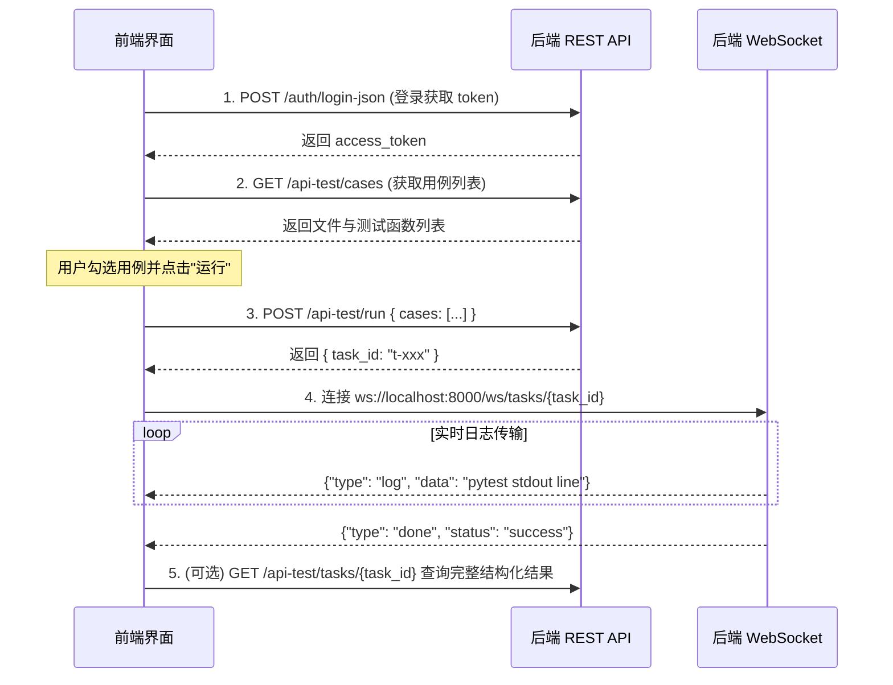

# 自动化测试平台 前后端对接 API 规范文档

> 本文档专为 **前端生成与接入（Frontend AI / Developer）** 编写。
> 后端服务基于 FastAPI 构建，遵循 RESTful 规范与 WebSocket 协议。

---

## 1. 全局约定与鉴权

### 1.1 基础信息
- **Base URL**: `http://localhost:8000` (开发环境)
- **WebSocket Base URL**: `ws://localhost:8000`
- **在线交互式文档 (Swagger UI)**: `http://localhost:8000/docs`
- **在线 OpenAPI JSON**: `http://localhost:8000/openapi.json`
- **CORS 跨域**: 已开启全局跨域支持（支持任意来源，允许携带凭证）

### 1.2 认证机制 (JWT Bearer Token)
除公开接口（如登录、健康检查）外，所有接口均需要在 HTTP Request Header 中携带 JWT Token：
```http
Authorization: Bearer <your_access_token>
```
若未携带或 Token 失效/过期，接口将返回 HTTP `401 Unauthorized`，前端应拦截此状态码并跳转至登录页。

### 1.3 统一错误响应结构
当请求参数错误、资源不存在或权限不足时，返回标准 HTTP 错误状态码（如 400, 401, 403, 404），Response Body 为：
```json
{
  "detail": "错误描述信息字符串或校验错误详情"
}
```

---

## 2. 核心业务流程时序 (前端交互逻辑)



---

## 3. REST API 接口详细说明

### 3.1 🔐 用户与鉴权模块 (Auth)

#### [POST] `/auth/login-json` - 用户登录
- **说明**: 前端推荐使用的 JSON 格式登录接口。
- **权限要求**: 公开接口
- **Request Headers**: `Content-Type: application/json`
- **Request Body**:
  ```json
  {
    "username": "admin",
    "password": "admin123"
  }
  ```
- **Response (200 OK)**:
  ```json
  {
    "access_token": "eyJhbGciOiJIUzI1NiIsInR5cCI6IkpXVCJ9...",
    "token_type": "bearer"
  }
  ```

#### [GET] `/auth/me` - 获取当前登录用户信息
- **说明**: 用于前端初始化时加载当前用户信息、判断权限。
- **权限要求**: 需携带 Token
- **Response (200 OK)**:
  ```json
  {
    "id": "u001",
    "username": "admin",
    "role": "admin",       // "admin" | "viewer"
    "created_at": "2026-10-16T15:43:00.000000"
  }
  ```

#### [GET] `/auth/users` - 获取用户列表
- **说明**: 用户管理列表。
- **权限要求**: 仅管理员 (`role == "admin"`)
- **Response (200 OK)**:
  ```json
  [
    {
      "id": "u001",
      "username": "admin",
      "role": "admin",
      "created_at": "2026-10-16T15:43:00.000000"
    }
  ]
  ```

#### [POST] `/auth/users` - 创建新用户
- **权限要求**: 仅管理员 (`role == "admin"`)
- **Request Body**:
  ```json
  {
    "username": "tester1",
    "password": "tester_password",
    "role": "viewer"      // "admin" | "viewer"
  }
  ```
- **Response (200 OK)**:
  ```json
  {
    "message": "用户创建成功",
    "id": "u5fa3bc"
  }
  ```

#### [DELETE] `/auth/users/{username}` - 删除用户
- **权限要求**: 仅管理员，禁止删除默认管理员 `admin`
- **Response (200 OK)**:
  ```json
  {
    "message": "用户 tester1 已删除"
  }
  ```

---

### 3.2 🖥️ UI 测试模块 (Playwright)

#### [GET] `/ui/cases` - 获取 UI 测试用例树/列表
- **说明**: 扫描 `testcases/ui/` 目录下所有 `test_*.py` 文件及其内部包含的 `test_*` 测试函数。
- **权限要求**: 需携带 Token
- **Response (200 OK)**:
  ```json
  [
    {
      "file": "test_example.py",
      "functions": [
        "test_baidu_search",
        "test_baidu_title"
      ]
    }
  ]
  ```

#### [POST] `/ui/run` - 执行 UI 测试用例
- **说明**: 传入选中的用例节点，后台以线程方式异步拉起 Playwright 执行并分配任务 ID。
- **权限要求**: 需携带 Token
- **Request Body**:
  ```json
  {
    "cases": [
      "test_example.py::test_baidu_search",
      "test_example.py::test_baidu_title"
    ],
    "headed": false        // 是否开启浏览器界面运行 (默认 false 为无头模式)
  }
  ```
- **Response (200 OK)**:
  ```json
  {
    "task_id": "t-20261016161652-553b53",
    "message": "任务已启动"
  }
  ```

#### [GET] `/ui/tasks` - UI 测试历史任务列表
- **说明**: 获取 UI 测试的历史执行记录列表（按执行时间倒序）。
- **权限要求**: 需携带 Token
- **Response (200 OK)**:
  ```json
  [
    {
      "task_id": "t-20261016161652-553b53",
      "module": "ui",
      "cases": ["test_example.py::test_baidu_search"],
      "status": "success",   // "running" | "success" | "failed"
      "started_at": "2026-10-16T16:16:52.123456",
      "finished_at": "2026-10-16T16:16:58.654321",
      "result_file": "storage/ui_results/t-xxx.json",
      "triggered_by": "admin"
    }
  ]
  ```

#### [GET] `/ui/tasks/{task_id}` - UI 任务详情与日志结果
- **说明**: 查看单次 UI 任务的执行状态、完整控制台日志输出与统计。
- **权限要求**: 需携带 Token
- **Response (200 OK)**:
  ```json
  {
    "task_id": "t-20261016161652-553b53",
    "module": "ui",
    "cases": ["test_example.py::test_baidu_search"],
    "status": "success",
    "started_at": "2026-10-16T16:16:52.123456",
    "finished_at": "2026-10-16T16:16:58.654321",
    "triggered_by": "admin",
    "logs": [
      "============================= test session starts =============================",
      "collecting ... collected 1 item",
      "testcases/ui/test_example.py::test_baidu_search PASSED                   [100%]",
      "============================== 1 passed in 4.21s =============================="
    ],
    "summary": null
  }
  ```

---

### 3.3 🔌 API 接口测试模块 (pytest)

#### [GET] `/api-test/cases` - 获取 API 测试用例列表
- **权限要求**: 需携带 Token
- **Response (200 OK)**:
  ```json
  [
    {
      "file": "test_example.py",
      "functions": [
        "test_get_posts",
        "test_get_post_by_id",
        "test_create_post",
        "test_get_nonexistent_post"
      ]
    }
  ]
  ```

#### [GET] `/api-test/cases/detail` - 查看用例详情与源码
- **权限要求**: 需携带 Token
- **Query 参数**:
  - `file` (string): 测试文件名，如 `test_example.py`
  - `function` (string, 可选): 单个测试函数名，如 `test_get_posts`
- **Response (200 OK)**:
  ```json
  {
    "file": "test_example.py",
    "function": "test_get_posts",
    "docstring": "获取帖子列表 - 状态码 200，返回非空数组",
    "code": "def test_get_posts():\n    ...",
    "full_code": "...",
    "lineno": 10,
    "end_lineno": 16,
    "functions": [...]
  }
  ```

#### [POST] `/api-test/cases` - 新建 API 测试用例
- **权限要求**: 需携带 Token
- **Request Body (向导模式或代码模式)**:
  ```json
  {
    "file": "test_example.py",
    "function_name": "test_query_user",
    "description": "测试查询用户",
    "method": "GET",
    "url": "https://jsonplaceholder.typicode.com/users/1",
    "headers": {"Content-Type": "application/json"},
    "body": null,
    "expected_status": 200,
    "code": null // 若填写则直接采用该 Python 代码
  }
  ```
- **Response (200 OK)**:
  ```json
  {
    "file": "test_example.py",
    "function": "test_query_user",
    "message": "测试用例创建成功",
    "case_id": "test_example.py::test_query_user"
  }
  ```

#### [PUT] `/api-test/cases/code` - 更新/保存用例文件源码
- **权限要求**: 需携带 Token
- **Request Body**:
  ```json
  {
    "file": "test_example.py",
    "code": "完整文件内容"
  }
  ```

#### [DELETE] `/api-test/cases` - 删除用例文件或单测试函数
- **权限要求**: 需携带 Token
- **Query 参数**:
  - `file` (string): 文件名
  - `function` (string, 可选): 若指定则仅删除该函数；若不指定则删除整个文件

#### [POST] `/api-test/run` - 执行 API 接口测试用例
- **权限要求**: 需携带 Token
- **Request Body**:
  ```json
  {
    "cases": [
      "test_example.py::test_get_posts",
      "test_example.py::test_get_post_by_id"
    ],
    "env": "staging"       // 可选：指定测试环境标识，通过环境变量 TEST_ENV 注入
  }
  ```
- **Response (200 OK)**:
  ```json
  {
    "task_id": "t-20261016161652-553b53",
    "message": "任务已启动"
  }
  ```

#### [GET] `/api-test/tasks` - API 测试历史任务列表
- **说明**: 结构与 UI tasks 一致，`module` 字段为 `"api"`。
- **Response (200 OK)**: 同 `/ui/tasks`。

#### [GET] `/api-test/tasks/{task_id}` - API 任务详情与日志结果
- **Response (200 OK)**: 同 `/ui/tasks/{task_id}`。

---

### 3.4 ⚡ 性能测试模块 (k6)

#### [GET] `/perf/cases` - 获取性能测试脚本列表
- **说明**: 扫描 `testcases/perf/` 目录下的所有 `*.js` 性能脚本，自动提取文件首行 `//` 注释作为脚本描述。
- **权限要求**: 需携带 Token
- **Response (200 OK)**:
  ```json
  [
    {
      "file": "script.js",
      "description": "JSONPlaceholder API 性能测试脚本"
    }
  ]
  ```

#### [POST] `/perf/run` - 运行性能测试脚本
- **说明**: 触发 k6 运行压测脚本。
- **权限要求**: 需携带 Token
- **Request Body**:
  ```json
  {
    "script": "script.js",      // 脚本相对路径 (对应 cases 返回的 file)
    "vus": 10,                 // 虚拟用户并发数 (Virtual Users)
    "duration": "30s",          // 压测持续时间 (如 "10s", "1m", "5m")
    "env": {                   // 可选：注入给 k6 的环境变量 (k6 -e KEY=VAL)
      "TARGET_HOST": "https://api.example.com"
    }
  }
  ```
- **Response (200 OK)**:
  ```json
  {
    "task_id": "t-20261016162500-112233",
    "message": "任务已启动"
  }
  ```

#### [GET] `/perf/tasks` - 性能测试历史记录
- **Response (200 OK)**: 列表返回，包含压测时的并发数、持续时间等 extra 字段。

#### [GET] `/perf/tasks/{task_id}` - 性能测试详情与报告输出
- **Response (200 OK)**: 包含 k6 运行期间的所有命令行日志输出（包含 RPS、P90/P95 响应时间表格）。

---

## 4. WebSocket 实时日志推送

通过 WebSocket 实现任务运行过程中的流式控制台日志传输，适合做类似终端（Terminal/Console）的实时刷屏效果。

### 4.1 连接协议
- **URL**: `ws://<HOST>:8000/ws/tasks/{task_id}`
- **示例**: `ws://localhost:8000/ws/tasks/t-20261016161652-553b53`

### 4.2 消息格式 (JSON 字符串)
前端建立连接后，接收的消息格式如下：

1. **实时日志推送 (`type: "log"`)**
   ```json
   {
     "type": "log",
     "data": "testcases/api/test_example.py::test_get_posts PASSED [ 50%]"
   }
   ```
2. **任务结束通知 (`type: "done"`)**
   ```json
   {
     "type": "done",
     "status": "success",    // "success" | "failed"
     "return_code": 0
   }
   ```
3. **任务未找到错误 (`type: "error"`)**
   ```json
   {
     "type": "error",
     "data": "task not found"
   }
   ```

### 4.3 断线与重连特性
- **内置历史回放**: 当客户端建立 WebSocket 连接时，如果该任务已生成部分日志，服务端会**先全量推送已有的历史日志**，然后再推送后续新增日志。
- **页面刷新友好**: 用户刷新页面后重新打开该任务详情抽屉/终端，直接重连此 WebSocket 地址即可还原完整日志上下文。

---

## 5. 前端 UI 组件推荐设计建议 (给前端开发/AI)

1. **导航菜单 (Sidebar / Nav)**
   - 🖥️ **UI 测试 (Playwright)**: 用例列表、运行面板、执行记录
   - 🔌 **API 接口测试 (pytest)**: 用例勾选、环境选择、运行记录
   - ⚡ **性能压测 (k6)**: 脚本选择、并发数(VUs)滑块、压测时长输入、执行监控
   - ⚙️ **系统与用户管理**: 当前登录人信息、用户增删查 (仅 admin 可见)

2. **用例选择面板 (Tree / Checkbox Table)**
   - 文件作为父级节点（可折叠），测试函数作为子级节点（带复选框）。
   - 支持全选当前文件、反选、多选组合批量运行。
   - 顶部提供「运行选中用例 (Run Selected)」悬浮按钮。

3. **执行与实时监控抽屉 (Log Drawer / Terminal Modal)**
   - 点击运行后立刻弹出 Drawer/Modal。
   - 使用 `@xterm/xterm` 或带暗黑背景的普通 `<pre>` 标签，字体设为等宽字体（如 `Consolas, Menlo, monospace`）。
   - 连接对应 `task_id` 的 WebSocket，收到 `log` 自动向下滚屏（Auto-scroll）。
   - 收到 `done` 时改变顶部 Badge 状态为绿色 `Success` 或红色 `Failed`。
